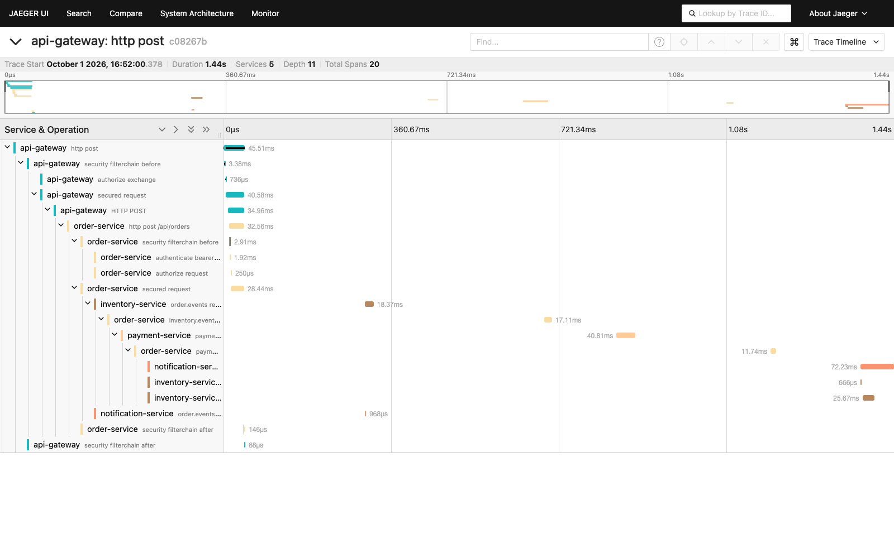
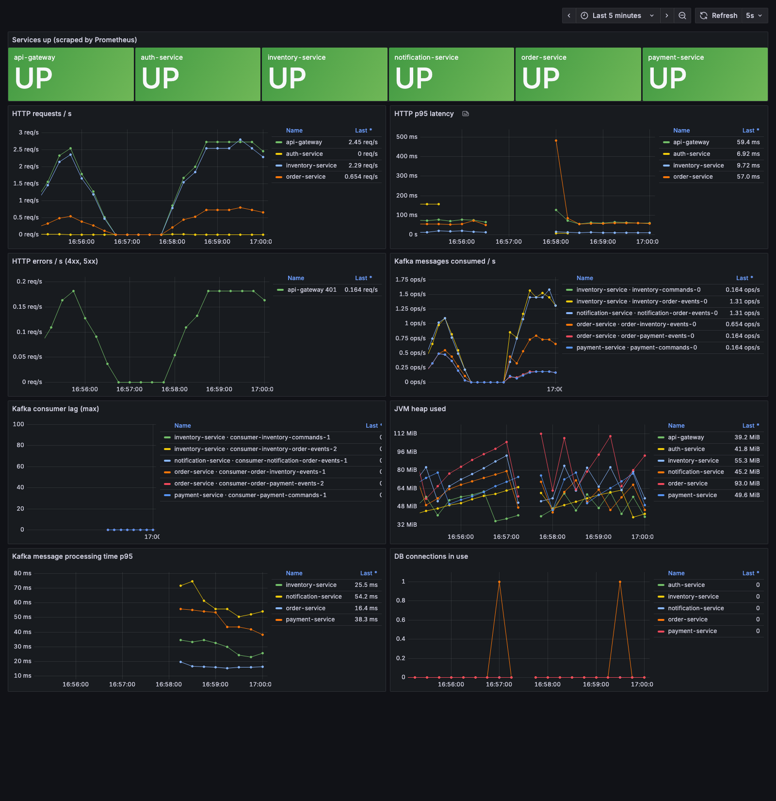

# Order Processing Microservices

[](https://github.com/besko2002/order-processing-microservices/actions/workflows/ci.yml)

An event-driven e-commerce order flow built as **six Spring Boot microservices** that talk through
**Kafka**. An order is placed, stock is reserved, payment is taken and the customer is notified —
and when any step fails, the system **compensates automatically** (orchestrated Saga).

Built to practise the patterns real distributed systems need: **Saga with compensation,
Transactional Outbox, idempotent consumers, Dead Letter Topics, database-per-service, an API
gateway with JWT and rate limiting, circuit breakers, and end-to-end correlation ids.**

## Architecture

```
                 Client (JWT)
                     │
             ┌───────▼────────┐  Spring Cloud Gateway: routing, JWT validation (JWKS),
             │  API Gateway   │  Redis rate limiting, correlation id, CORS
             └──┬───┬───┬───┬─┘
       REST     │   │   │   │
   ┌────────────▼┐ ┌▼───┴───▼──────┐ ┌──────────────┐
   │ auth-service│ │ order-service │ │  inventory   │──┐
   │ RS256 JWT + │ │ Saga          │ │  -service    │  │
   │ JWKS        │ │ orchestrator  │ └──────▲───────┘  │
   └─────────────┘ └──┬─────▲──────┘        │          │
                      │     │   Kafka topics (events + commands, keyed by orderId)
      ────────────────▼─────┴───────────────┴──────────▼────────────────
                      │     ▲                          │
             ┌────────▼─────┴┐               ┌─────────▼────────────┐
             │payment-service│               │ notification-service │──► email (MailHog)
             └───────────────┘               └──────────────────────┘

   Each service owns its own PostgreSQL database (auth_db, order_db, inventory_db, payment_db,
   notification_db). No service reads another service's tables.
```

| Module | Port | Responsibility |
|---|---|---|
| `api-gateway` | 8080 | Single entry point: routes, JWT check, rate limiting (Redis), correlation id |
| `auth-service` | 8081 | Register / login, issues RS256 JWTs, publishes the JWKS |
| `order-service` | 8082 | Orders, idempotent checkout, **Saga orchestrator**, timeout sweeper |
| `inventory-service` | 8083 | Product catalogue, stock reservations (all-or-nothing, no overselling) |
| `payment-service` | 8084 | Simulated payment provider: authorize, decline, refund |
| `notification-service` | 8085 | Emails the customer when an order is confirmed / cancelled / rejected |
| `common-events` | – | Event & command records, topic names, header names |
| `service-support` | – | Shared auto-configuration: security, errors, correlation id, outbox, idempotency, DLT, Swagger |

## The order Saga

```
POST /api/orders ─► order PENDING ─► OrderCreated ─► inventory reserves stock
                                                      ├─ StockRejected ─► order REJECTED
                                                      └─ StockReserved ─► ProcessPayment ─► payment
                                                                           ├─ PaymentCompleted ─► CONFIRMED + CommitStock
                                                                           └─ PaymentFailed ─► ReleaseStock ─► CANCELLED
POST /api/orders/{id}/cancel (CONFIRMED) ─► RefundPayment + ReleaseStock ─► CANCELLATION_PENDING ─► PaymentRefunded ─► CANCELLED
Orders stuck longer than ORDER_SAGA_TIMEOUT are cancelled with compensation by a sweeper.
```

| Topic | Messages | Producer → Consumer |
|---|---|---|
| `order.events` | OrderCreated, OrderConfirmed, OrderCancelled, OrderRejected | order → inventory, notification |
| `inventory.events` | StockReserved, StockRejected | inventory → order |
| `inventory.commands` | CommitStock, ReleaseStock | order → inventory |
| `payment.commands` | ProcessPayment, RefundPayment | order → payment |
| `payment.events` | PaymentCompleted, PaymentFailed, PaymentRefunded | payment → order |
| `<topic>.DLT` | messages that could not be processed | any consumer → operator |

## Reliability patterns

- **Transactional Outbox** — every outgoing message is written to an `outbox_events` table in the
  same database transaction as the state change, then published by a relay
  (`SELECT … FOR UPDATE SKIP LOCKED`, safe with several instances; `acks=all`, idempotent producer,
  per-order ordering). No lost events, no events for rolled-back changes.
- **Idempotent consumers** — each consumer records the event id in `processed_events` in the same
  transaction as its work, so Kafka redeliveries are no-ops.
- **Dead Letter Topics** — 3 retries with exponential backoff, then `<topic>.DLT`; malformed or
  unknown messages go to the DLT immediately. Consumers keep running.
- **No overselling** — stock rows are locked in id order (deadlock-free) with optimistic-locking
  retry; a 20-thread / 10-unit concurrency test proves exactly 10 reservations succeed.
- **Resilience** — order-service prices items through inventory with a Resilience4j retry +
  circuit breaker; when inventory is down the API answers `503` with `Retry-After`.
- **Idempotent checkout** — `Idempotency-Key` header: a replay returns the same order, a different
  body with the same key is `409`.
- **Defense in depth** — the gateway validates the JWT, and every service validates it again.
  Client-supplied `X-User-Id` / `X-User-Roles` headers are stripped at the edge.
- **Correlation id** — `X-Correlation-Id` travels from the HTTP request through every Kafka hop
  (headers) and appears in every service's log line.

## Observability

Metrics, traces and logs are wired into every service:

- **Metrics** — Micrometer → Prometheus (`/actuator/prometheus`): HTTP rate / p95 latency / errors,
  Kafka messages consumed, processing time and consumer lag, JVM heap, DB connections.
- **Distributed tracing** — Micrometer Tracing + OpenTelemetry → **Jaeger**. The trace context is
  stored with each outbox row and sent as a W3C `traceparent` Kafka header, so **one trace follows an
  order across all services, through Kafka and the outbox** (gateway → order → inventory → payment →
  notification).
- **Logs** — every line carries the correlation id and the trace id:
  `[order-service,<correlationId>,<traceId>]`.
- **Grafana** — a provisioned "Order Processing — Overview" dashboard (opens as the home page).

```bash
docker compose --profile observability up -d --build   # Grafana :3000, Prometheus :9090, Jaeger :16686
```

**One order traced across five services (Jaeger)**



**Grafana dashboard under load**



## Tech stack

Java 21 · Spring Boot 3.5 · Spring Cloud Gateway 2025.0 · Spring Kafka (Kafka 4, KRaft) ·
Spring Data JPA · PostgreSQL 16 · Micrometer · OpenTelemetry · Prometheus · Grafana · Jaeger · Flyway · Redis · Spring Security OAuth2 Resource Server (RS256 /
JWKS) · Resilience4j · springdoc-openapi · Testcontainers · Docker Compose · Maven multi-module.

## Run it

Requirements: JDK 21 and Docker (sized for Docker Desktop with ~4 GB).

**Everything in Docker:**

```bash
docker compose --profile app up -d --build
```

**Infrastructure in Docker, services on the host** (handy while developing):

```bash
docker compose up -d --wait                       # Postgres, Kafka, Redis, MailHog
./mvnw -DskipTests install
java -jar auth-service/target/auth-service-0.0.1-SNAPSHOT.jar &
INVENTORY_SEED_DEMO=true java -jar inventory-service/target/inventory-service-0.0.1-SNAPSHOT.jar &
java -jar order-service/target/order-service-0.0.1-SNAPSHOT.jar &
java -jar payment-service/target/payment-service-0.0.1-SNAPSHOT.jar &
java -jar notification-service/target/notification-service-0.0.1-SNAPSHOT.jar &
java -jar api-gateway/target/api-gateway-0.0.1-SNAPSHOT.jar &
```

| What | Where |
|---|---|
| API (always through the gateway) | http://localhost:8080 |
| Swagger UI of a service | http://localhost:8081..8085/swagger-ui.html |
| Emails (MailHog) | http://localhost:8025 |
| Grafana / Prometheus / Jaeger | http://localhost:3000 · :9090 · :16686 (profile `observability`) |

Host ports avoid common defaults: Postgres **5435**, Kafka **9094**, Redis **6380**.

## Try the flow

```bash
# register and keep the token
TOKEN=$(curl -s localhost:8080/api/auth/register -H 'Content-Type: application/json' \
  -d '{"name":"Ada","email":"ada@example.com","password":"Password123"}' | jq -r .accessToken)

# public catalogue (demo products)
curl -s localhost:8080/api/products | jq '.content[] | {id, sku, price, availableQuantity}'

# place an order (under 1000 → CONFIRMED, over 1000 → payment declined → CANCELLED)
ORDER=$(curl -s localhost:8080/api/orders -H "Authorization: Bearer $TOKEN" \
  -H 'Content-Type: application/json' -H 'Idempotency-Key: checkout-1' \
  -d '{"items":[{"productId":"<id>","quantity":1}]}' | jq -r .id)

curl -s localhost:8080/api/orders/$ORDER -H "Authorization: Bearer $TOKEN" | jq .status
curl -s localhost:8080/api/payments/order/$ORDER -H "Authorization: Bearer $TOKEN" | jq .status
curl -s -X POST localhost:8080/api/orders/$ORDER/cancel -H "Authorization: Bearer $TOKEN"
curl -s localhost:8080/api/notifications/me -H "Authorization: Bearer $TOKEN" | jq .
```

A seeded admin (`admin@orders.local` / `Admin@12345`, change it with `AUTH_ADMIN_*`) can manage
products under `/api/inventory/**`.

## API overview (through the gateway)

| Method & path | Access |
|---|---|
| `POST /api/auth/register`, `POST /api/auth/login` | public |
| `GET /api/auth/me` | user |
| `GET /api/products`, `GET /api/products/{id}` | public |
| `POST/PUT/PATCH/DELETE /api/inventory/products/**`, `GET /api/inventory/reservations` | admin |
| `POST /api/orders` (optional `Idempotency-Key`) | user |
| `GET /api/orders/me`, `GET /api/orders/{id}`, `POST /api/orders/{id}/cancel` | owner or admin |
| `GET /api/orders` | admin |
| `GET /api/payments/order/{orderId}` | owner or admin |
| `GET /api/notifications/me` | user |

## Configuration

Every setting has a working local default and can be overridden by an environment variable; the
full list with explanations is in [`.env.example`](.env.example). Notable ones:
`AUTH_JWT_PRIVATE_KEY` / `AUTH_JWT_PUBLIC_KEY` (otherwise an ephemeral key pair is generated at
startup), `PAYMENT_DECLINE_ABOVE` (default 1000.00), `ORDER_SAGA_TIMEOUT` (default 2 minutes),
`RATE_LIMIT_REPLENISH_RATE` / `RATE_LIMIT_BURST_CAPACITY`, `INVENTORY_SEED_DEMO`.

## Tests

Over 280 tests, most of them integration tests against **real PostgreSQL and Kafka** started by
Testcontainers (Docker must be running): the Saga transitions and compensations, outbox
atomicity and relay retries, idempotent consumers, the DLT, stock concurrency, the gateway's
security and rate limiting, and the circuit breaker.

```bash
./mvnw verify
```

## Known limitations

- Payments are simulated (deterministic: decline above a threshold, optional failure rate).
- Order events carry the customer id but not the email address, so notification emails go to a
  demo address `<customerId>@customers.orders.local` (visible in MailHog).
- Without configured RSA keys, auth-service generates a new key pair on every start, so tokens
  issued before a restart stop working.
